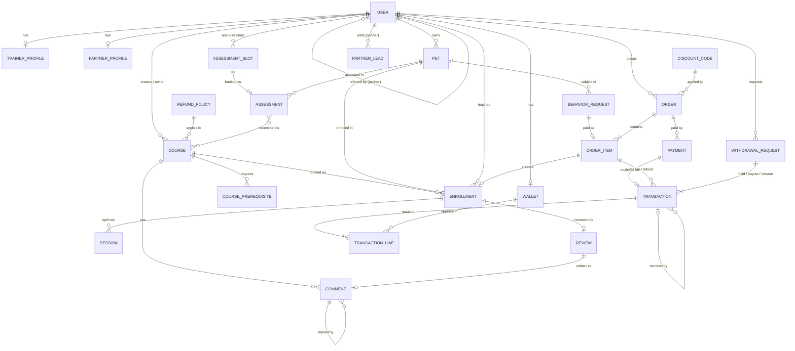

# Website Specification Document — Phase One

### 1. Project Objective

The website of **K9 Training** (آموزش K9), one dog trainer's private practice. The site sells him and his courses: customers meet him on the site, book a **free assessment** for their dog, and then buy **private courses** that he (or sometimes his assistant) teaches one dog at a time, at the customer's home or outside. A dog that already has a record on the site books its next course directly. Customers pay online or from their in-app wallet. Partners (pet shops, clinics, groomers) bring in customers through referral links and earn a commission on their purchases.

The course catalog and the owner's rules come from [zurvan-courses.md](zurvan-courses.md). Where this spec and that doc disagree about a course, the courses doc wins.

**From one trainer's site to a training app.** The site launches as the head trainer's own, but it is built as an app for pet training: every trainer has their own page, and trainers (his assistants first) can submit new courses that the Admin approves. An assistant can also take over a course or a single dog's training. That is the step from the owner's website to a platform with more trainers.

**Not in phase one:** group classes, seats, class minimums, waitlists and a training venue. Every course is private. Phase one is for **dogs only**.

---

### 2. User Roles & Authentication

- **Roles:** Admin (Owner), Trainer, Partner, Customer.
- **Authentication:** All users register and log in via Phone Number using SMS OTP (One-Time Password).
- Each phone number has **exactly one role** in phase one.

| Role         | Main capabilities                                                                                                                                                                                                                  |
| ------------ | ---------------------------------------------------------------------------------------------------------------------------------------------------------------------------------------------------------------------------------- |
| **Admin**    | Super admin. Manages everything: users, the course catalog, assessments, enrollments, orders, refunds, discounts, wallets, withdrawals, commissions, comments, settings.                                                           |
| **Trainer**  | The head trainer and his assistants. Has a public page, submits courses for approval, opens assessment slots, runs assessments, schedules and records sessions, reviews behavior requests, replies to comments, sees own earnings. |
| **Partner**  | Sees own referral link and QR code, adds pre-registration leads, views referred customers, revenue and commission.                                                                                                                 |
| **Customer** | Manages own dogs, books assessments, buys courses and tests, sends behavior requests, follows each dog's record, asks questions, reviews courses and trainers.                                                                     |

**OTP rules:**

- Phone numbers are normalized to one format (e.g. `09xxxxxxxxx`) before storing or matching.
- The code is 5 digits, valid for **2 minutes**, and can be resent after **60 seconds**.
- After **5 wrong attempts** the code is invalidated and the user must request a new one.
- Requests are rate-limited per phone number and per IP to prevent SMS abuse.
- Only customers can self-register. Trainer and Partner accounts are created or promoted by an Admin.
- Blocked users cannot log in.

---

### 3. Core Features & Business Logic

#### 3.1 The Catalog

The launch catalog is the head trainer's own, listed in [zurvan-courses.md](zurvan-courses.md). It has these families:

| Family       | Courses                                                           | Notes                                                                                  |
| ------------ | ----------------------------------------------------------------- | -------------------------------------------------------------------------------------- |
| Basics       | سگ خونگی (House manner), سگ اجتماعی (CGC)                         | The owner wants every dog to have CGC. The site never says so; see 3.3.                |
| Obedience    | فرمان‌پذیری مقدماتی (Elementary) → فرمان‌پذیری حرفه‌ای (Advanced) | Two equivalent paths with the same outcome and different prices. A customer picks one. |
| Companion    | سگ همدم ۱ → ۲ → ۳ → ۴ (Companion dog 1–4)                         |                                                                                        |
| Six-month    | دوره‌ی مخصوص سگ‌های شش‌ماهه (BMC)                                 | For dogs between 6 and 7 months. The owner wants almost every dog to take it; see 3.3. |
| Working dogs | نگهبان محل، بادی‌گارد، سگ سرویس، سگ آلارم، ردیاب                  | Details still open (see 5).                                                            |
| Sport dogs   | BH، IGP 1–3، FH، WUSV                                             | Details still open (see 5).                                                            |
| Behavior     | اصلاح رفتار (Behavior modification)                               | For any age and breed. Starts from a request with a video (see 3.7).                   |

Every course has a minimum age (and BMC a maximum), an approximate number of sessions, where it is taught (**at home**, **outside**, or **mostly outside**), and its prerequisites. **Boarding is optional for every course:** the customer can choose to leave the dog at a boarding kennel, where the training continues.

#### 3.2 Course Creation & Approval

- Courses can be created by both **Admins** and **Trainers**. Courses created by an Admin are approved directly.
- Courses submitted by Trainers require **Admin approval** before they can be booked. This is how an assistant releases a new course.
- The trainer proposes the course's price (and boarding and test prices) and picks its **Refund Policy** from the presets the Admin has defined (see 3.9).
- The course's **Trainer Share** is pre-filled from the platform default (see 3.11). The trainer sees it when submitting; the Admin can change it during review like any other field.

**Reviewing a submitted course.** The Admin can:

- **Approve** it as is.
- **Reject** it with a written reason. The trainer sees the reason, edits the course, and resubmits it.
- **Edit** any field (including prices, refund policy and trainer share) and then either:
  - **Send it back to the trainer for confirmation.** The trainer sees each changed field with its old and new value, plus the Admin's note. Accepting approves the course; editing it again resubmits it for approval.
  - **Force approve** it with the changes. The trainer is notified of what changed.

**After approval:**

- Trainers can still edit text and images.
- Prerequisites, age range, prices, refund policy and trainer share are Admin-only, because they change which dogs can book, what customers are promised, or what the trainer earns. Admin edits on an approved course apply immediately, apply to **new** bookings only, and the trainer is notified.
- Each course has an **owner trainer**, who gets its new enrollments. The Admin can change the owner (e.g. an assistant **takes over** the course) and can reassign any single enrollment to another trainer.
- An Admin can **archive** a course. Archived courses can't be booked, but existing enrollments continue and passing them still counts as a prerequisite.

**Course status flow:**

```text
Draft → Pending Approval → Approved → Archived

Pending Approval → Rejected                       → (trainer edits) → Pending Approval
Pending Approval → Awaiting Trainer Confirmation → (trainer accepts) → Approved
                                                 → (trainer edits)   → Pending Approval
Pending Approval → (Admin edits + force approve)  → Approved
```

Only **Approved** courses are shown and can be booked.

#### 3.3 Free Assessment

Every new dog starts with a free assessment, where the trainer meets the dog and recommends where to start.

**Slots:**

- A trainer opens **assessment slots**: a start time and a duration (default 60 minutes). They can open several at once (e.g. "every Saturday at 10 and 17 for the next four weeks").
- A slot can be booked **once**. If two customers race for the same slot, exactly one gets it and the other is told it was just taken.
- The trainer can close an open slot, or cancel a booked one with a reason (the customer is notified and can pick another slot).

**Booking:**

1. The customer picks one of their dogs (or adds one), the **training goal** (`Home`, `Sport` or `Work`), what they want to change, and where to meet (their address or a meeting point).
2. They pick an open slot. The assessment is `Booked`, and both sides are notified.
3. The customer can cancel until the slot starts; the slot opens again.

**After the meeting**, the trainer marks the assessment `Completed` (or `No Show`) and records:

- notes about the dog, shown to the customer;
- one or more **recommended courses**, in the order to take them.

The recommendations start **pre-filled** with the owner's standing rules, which the site never states as rules: **CGC** for a dog that hasn't passed it or its test, and **BMC** for a dog that will be 6–7 months old soon and hasn't taken it. The trainer adds the rest and can remove these when they don't fit.

The customer sees the recommendations on the dog's page, each with a "book" button.

**Who needs one:** a dog needs a completed assessment before its first course, unless it already has a **record**. A dog has a record if it has a completed assessment, or an enrollment with at least one held session, or a trainer or Admin has marked it as known (for dogs they trained before the site existed). Tests (3.6) and behavior requests (3.7) don't need an assessment.

**Paid assessments.** The owner mentioned several paid assessment types beside the free one. They are not in phase one until they are defined (see 5).

#### 3.4 Booking a Course

A dog with a record can book any approved course it is eligible for (see 3.8), not only the recommended ones.

1. The customer picks the course and the dog, chooses **boarding** or not, gives the address (for courses at home or outside), and writes the days and times that suit them.
2. Checkout: discount code, wallet balance, then the gateway (see 3.12).
3. When payment succeeds, the **enrollment** is created with the course's owner trainer and the status `Scheduling`. Both sides are notified.

There are no seats: the only limit is the trainer's time. If the trainer can't take a paid enrollment, the Admin cancels it and the customer gets a full refund (see 3.9).

**Enrollment status flow:**

```text
Scheduling → Active → Passed
                    → Failed
     ↓          ↓
 Cancelled  Cancelled
```

- **Scheduling:** paid; the trainer is arranging the first session with the customer.
- **Active:** the first session is scheduled. Set automatically.
- **Passed / Failed:** the trainer records the result and a note at the end. Passing a course satisfies prerequisites on it.
- **Cancelled:** by the customer (with a refund by policy), or by a trainer or Admin (full refund of what's left, see 3.9).

A dog can't have two active (`Scheduling` or `Active`) enrollments in the same course. **Retakes are allowed:** if the dog has already passed the course, the customer sees a notice (e.g. "لئو این دوره را قبلاً با موفقیت گذرانده است") and must confirm.

#### 3.5 Sessions

- The trainer schedules each session of an enrollment: date, time, duration, and place (the customer's address, an outside location, or the boarding kennel). The customer is notified, and gets a reminder the day before.
- The number of sessions on a course is approximate ("حدوداً ۷ جلسه"). The trainer can add or remove sessions on an enrollment; the price doesn't change.
- Either side can ask to reschedule. The trainer changes the time; the customer is notified.
- After each session the trainer marks it `Held` or `Missed` and can write a note for the customer. A session the customer cancels too late (see 5) is marked `Missed` and counts as held for refunds.
- The trainer warns themselves of overlaps: scheduling a session over another session or a booked assessment shows a warning, but isn't blocked (the assistant may take one of them).

#### 3.6 Level Tests

A dog can skip a course by passing its **test** instead. The courses doc names these:

- **Companion 1, 2 and 3 tests:** passing one counts as having passed that level, so the dog can start the next level (and dogs trained elsewhere can join the path midway).
- **CGC test:** the owner said it is paid.

How it works:

- A course offers a test when it has a **test price**. The test is bought like a course and becomes an enrollment of kind `Test`, with a single session.
- The trainer records `Passed` or `Failed`. A passed test satisfies prerequisites on its course, exactly like passing the course.
- Tests don't need an assessment first, since they are an assessment themselves.

#### 3.7 Behavior Modification Requests

Behavior modification is for any age and breed, and starts from a request instead of an assessment:

1. The customer picks the dog, a **problem category**, writes a description, and uploads one or more **videos** of the behavior. Categories: پرخاشگری به انسان، پرخاشگری به حیوان، پرخاشگری به صاحب، گاز گرفتن بی‌مورد، گاز گرفتن بازیگوشانه، اضطراب جدایی، خطای دستشویی، مدفوع‌خواری، آشغال‌خواری، سایر.
2. The trainer reviews it and either **proposes a plan** (number of sessions, price, a note) or **declines** with a reason (e.g. "first a free assessment, in person").
3. The customer accepts the plan and pays, or lets it expire. Paying creates an enrollment of the behavior modification course with the plan's sessions and price, and the rest works like any course (3.4, 3.5).

**Request status flow:** `Submitted → Proposed → Paid`, or `Declined`, `Withdrawn` (by the customer), `Expired` (the plan wasn't paid in time).

#### 3.8 Prerequisites & Eligibility

- Customers enroll their **dogs** (not themselves).
- A course can require one or more other courses. A requirement is met when the dog has **passed** that course or **passed its test**. For the Companion path the courses doc says exactly this: "level 1, or passing the level 1 test".
- A course can limit eligible dogs by **age** (minimum and maximum, in months). Age is checked at booking.
- If the dog doesn't meet the rules, booking is disabled for it with an explanation written by the Admin (e.g. "لئو اول باید «سگ همدم ۱» یا تست آن را بگذراند").
- Prerequisites can't form a cycle (course A requires B, B requires A).
- CGC and BMC are not prerequisites of anything. They reach every dog through the trainer's recommendations (3.3), not through rules shown on the site.

#### 3.9 Cancellation & Refunds

There's no start date to count days from: a private course starts when its first session is held. So refunds depend on the sessions.

- **Before the first session is held,** a customer who cancels always gets a **full refund**.
- **After that,** the course's **Refund Policy** decides what share of the **unheld** sessions comes back. The Admin defines a few presets, and each course uses one. Example presets:

| Preset              | Refund of the unheld sessions' share |
| ------------------- | ------------------------------------ |
| منعطف (Flexible)    | 100%                                 |
| متوسط (Moderate)    | 50%                                  |
| سخت‌گیرانه (Strict) | 0%                                   |

- **Tests** are refunded in full until a set time before the test session, and not after (see 5).
- If a **trainer or the Admin** cancels an enrollment (e.g. the trainer can't take it), the customer gets back the whole share of the unheld sessions, whatever the policy.
- Refunds apply to what the customer **actually paid** for that enrollment, after any discount.
- The policy is **copied onto each order item** at purchase time, so later changes to the course don't affect existing enrollments.
- A refund is a **mirror** of the enrollment's purchase transaction (see 3.12): every wallet that received a share gives it back, and the money lands in the customer's **wallet** instantly. The customer can spend it on another course or withdraw it (see 3.13). How a partial refund is split between the wallets is an open business question (see 5).
- The Admin can issue a manual refund of any amount by creating a transaction, optionally starting from the mirror of the purchase.

#### 3.10 Discount Codes

The Admin creates discount codes. Each code has:

- **Type and value:** a percentage (with an optional maximum discount amount) or a fixed amount.
- **Validity period:** start and end date.
- **Usage limits:** total number of uses, and uses per customer.
- **Minimum order amount** (optional).
- **Scope:** all courses, or only selected courses. Tests and behavior plans count as their course.
- **First order only** (optional): only for customers who have never had a paid order.

**Rules:**

- One code per order.
- A fixed-amount discount is split across the order's items in proportion to their price, so each enrollment has a known paid amount for refunds.
- A use is counted when the order is paid. If the order is fully refunded, the use is given back.
- Which share absorbs a discount (trainer, admin or partner) is an open business question (see 5).

#### 3.11 Revenue Split

- Every **purchased unit** (one enrollment: a course, a test or a behavior plan for one dog) creates one **purchase transaction** when its order is paid (see 3.12). It sends the unit's paid amount from the customer's wallet to the wallets of the enrollment's **trainer**, the **Admin**, and the customer's **partner** (if they have one).
- How the amount is divided is an open business question (see 5). The current draft is the course's **Trainer Share** percentage.
- The transaction's lines are the permanent record of the split. Changing a course's share or the commission formula **never changes past transactions**. If the Admin wants the change to apply to past sales, they work out the difference themselves and create transactions for it (e.g. `Trainer −X, Partner +X`), or leave the past as it is.
- If the Admin reassigns an enrollment to another trainer (e.g. the assistant), the purchase stays with the original trainer. The Admin moves money between them by hand if needed.
- The trainer dashboard shows each enrollment's earning (their lines in its purchase transaction, minus refunds) and their wallet history.

**Example:** a course costs 100, the Admin takes 20%, and the partner gets 10 per sale. A referred customer buys it for one dog:

| Wallet   | Purchase | Refund (mirror) |
| -------- | -------: | --------------: |
| Customer |     −100 |            +100 |
| Trainer  |      +70 |             −70 |
| Admin    |      +20 |             −20 |
| Partner  |      +10 |             −10 |
| **Sum**  |    **0** |           **0** |

If 10 referred customers buy, that's 10 purchase transactions like this. If one of them later cancels, only their transaction is mirrored.

#### 3.12 Wallets & Transactions

All money in the app is tracked as **transactions between wallets**. The app never moves real money by itself: card payments come in through the payment gateway, and the owner pays people from their own bank app and records it here.

**Wallets:**

- **User wallets:** every customer, trainer and partner has one, created with the account.
- **System wallets:**
  - **Admin:** the owner's wallet. It receives the platform's share of each sale.
  - **Gateway:** where online card payments come from. Its balance is minus the total received online.
  - **Bank:** where payouts go. Its balance is the total paid out from the owner's bank account.
  - **Withdrawal Hold:** money of withdrawal requests waiting for the Admin (see 3.13).
- A wallet's **balance** is the sum of its lines.
- **Any wallet can be negative.** Example: a trainer was paid out, then a customer cancelled and the trainer's share was mirrored back. The Admin has a list of negative balances, and the owner settles them with the user outside the app.

**Transactions:**

- A transaction is a list of **lines**. Each line is one wallet and a signed amount: negative lines are the **senders**, positive lines are the **receivers**. A transaction can have any number of senders and receivers.
- **The lines of a transaction always add up to 0.** Money is never created or lost inside the app, only moved, so all wallets together always add up to 0.
- A transaction's **sum** is the total of its positive lines (e.g. 100 in the example in 3.11).
- Each wallet appears at most once in a transaction.
- Transactions are created in only two ways: by the **system** (payment, purchase, automatic refund, withdrawal steps) or by the **Admin**.
- **Transactions are never edited or deleted.** A mistake is fixed with a new transaction, usually its mirror.

**Mirror:**

- Any transaction can be **mirrored**. Mirroring opens a new transaction prefilled with every line's sign flipped. The Admin can change any field before saving.
- The new transaction stores which transaction it mirrors, so the history reads "بازگشت تراکنش #۱۲۳". If a transaction was already mirrored, the Admin sees a warning but can still go ahead.
- Automatic refunds (customer cancels, trainer or Admin cancels) are mirrors created by the system: exact for a full refund, proportional for a partial one.

**Admin transactions:**

- The Admin can create a transaction between **any wallets**, user or system, with any senders and receivers and a description.
- Examples: adjusting past sales after a formula change (`Trainer −X, Partner +X`), recording money a user paid the owner directly (`Bank −X, Customer +X`), or paying a user in parts after declining their withdrawal (`User −X, Bank +X` per transfer).

**What users see:**

- Each user sees their **balance** and **their own lines**, with each transaction's description and date. They never see the other lines (e.g. a customer doesn't see how their payment was split).
- That's all users can do with the wallet, apart from paying with it at checkout and requesting a withdrawal.

**Paying for an order:**

- At checkout, a positive wallet balance is used first and the rest is paid through the gateway.
- Nothing moves until payment succeeds. Then, in **one database transaction**:
  1. If part was paid online: `Gateway −g, Customer +g`, linked to the Payment.
  2. For each purchased unit: its purchase transaction (see 3.11), and its enrollment.
- An order paid fully from the wallet skips step 1 and is paid immediately.
- So the same balance can't be spent twice, a customer can have only **one pending order that uses wallet balance** at a time.
- Gateway payments are also logged separately as **Payments**, which are immutable (see entity 16).
- **Installments** (e.g. Snapp Pay) are not in phase one (see 5).

#### 3.13 Withdrawal

1. Any user with a positive balance can request a withdrawal of an amount up to their balance, with a Sheba number and account holder name. The user is told it will be handled **within 72 hours**. Only one request can be pending at a time.
2. The system immediately moves the amount to the hold: `User −X, Withdrawal Hold +X`. The user sees it as "در انتظار برداشت" and can't spend it.
3. The Admin sees pending requests in a **withdrawal queue**, oldest first, with requests older than 72 hours highlighted.
4. **Approve:** the Admin pays the amount from their bank app, enters the bank tracking code, and approves: `Withdrawal Hold −X, Bank +X`.
5. **Decline** (with a note shown to the user), or the **user cancels** while it's pending: the hold transaction is mirrored and the money returns to the user's wallet. After declining, the owner can still pay the user in parts with Admin transactions (see 3.12).

The user is notified by SMS when their request is approved or declined.

#### 3.14 Partner (Affiliate) System

- Partners have a dedicated dashboard with a unique **Referral Link** and **QR Code**.
- **Dashboard Metrics:** Partners can view referred customers and the total revenue generated from their purchases, filterable by date range. Each referred customer shows signup date, number of paid orders, and total spend. The dashboard also shows the commission earned (their lines in purchase transactions, minus refunds) and their wallet.
- **Pre-registration Attribution:** Partners can enter a customer's phone number before the customer signs up. If that customer later registers without a referral link, they are automatically credited to that Partner.
- **Commission:** the partner's commission is **their line in each purchase transaction** of a referred customer (see 3.11). How it's calculated is an open business question (see 5).

**Attribution rules:**

- A customer is attributed to **one partner, permanently**, at the moment of registration.
- A referral link (or QR code) used at signup takes priority over a pre-registration lead.
- If several partners add the same phone number as a lead, the **earliest** lead wins.
- A lead can't be added for a phone number that is already registered.
- Each order stores the partner it was attributed to at purchase time, so dashboard numbers don't change retroactively.
- Only **paid** orders count toward revenue. Refunded amounts are subtracted.

#### 3.15 Reviews, Comments & Questions

**Reviews:**

- After an enrollment is **Passed** or **Failed**, the customer can review it once.
- A review has a **course rating** (1–5), a **trainer rating** (1–5), and an optional **comment**.
- Ratings count toward the averages immediately. The comment follows the comment rules below.
- Course and trainer averages and counts are shown on the course page and the trainer's page (3.17).

**Comments and questions:**

- Any logged-in customer can post a comment or question on a course page, even before booking. A review's comment appears in the same list, with its ratings.
- Customer comments are shown **only after Admin approval**. The Admin can approve or reject a comment with a reason.
- Any trainer and the Admin can **reply**. Replies are shown immediately. Replies are one level deep.
- The customer is notified when their comment gets a reply.
- The Admin can **hide** any comment or reply at any time, with a reason. Hiding a comment also hides all its replies. A hidden comment can be restored.
- Comments show the customer's first name, and the dog's name when there is one (e.g. "سارا، همراه لئو").

#### 3.16 Notifications

SMS goes to the customer for: assessment booked, cancelled or reminder (the day before); enrollment paid; a session scheduled, changed, or reminder (the day before); a result recorded; a behavior plan proposed or declined; a refund; a comment reply; a withdrawal approved or declined. Trainers get an SMS for a new assessment booking, a new paid enrollment and a new behavior request.

#### 3.17 Trainer Pages

- Every trainer has a **public page**: photo, bio, years of experience, specialties, certificates, the approved courses they own, their rating and reviews.
- Course pages show the owner trainer with a link to their page. An enrollment shows its trainer, so a customer whose dog moved to an assistant can see who that is.
- The **head trainer** is featured on the home page and in the site's copy. The other trainers appear on their own pages and on the courses they own.
- The Admin creates trainer accounts and can mark a trainer as **verified**, which shows a badge on their page.

---

### 4. Database Entities & Relationships

#### Shared conventions

These apply to every entity and are not repeated in each table:

- **ID:** UUID primary key.
- **Timestamps:** `Created At` and `Updated At` on every table, stored in UTC and shown in the Jalali calendar.
- **Soft delete:** entities with history (User, Pet, Course, Enrollment) use `Deleted At` instead of being removed.
- **Money:** stored as integers in **Rial**. No floating-point amounts. The UI shows toman (Rial ÷ 10), shortened as "هزار" or "میلیون".
- **Snapshots:** values that can change later (price, partner, refund policy) are copied at the moment they're used. The split of each sale is recorded by its purchase transaction.
- **Append-only money:** Payments, Transactions and Transaction Lines are never edited or deleted. Corrections are new transactions.

#### Relationship overview



#### **1. User**

| Field                    | Notes                                          |
| ------------------------ | ---------------------------------------------- |
| Phone Number             | Unique, normalized.                            |
| Phone Verified At        | Set on first successful OTP.                   |
| First Name, Last Name    | Used in personal greetings.                    |
| Avatar                   | Optional image.                                |
| Role                     | `Admin`, `Trainer`, `Partner`, `Customer`.     |
| Status                   | `Active`, `Blocked`.                           |
| Referred By (Partner ID) | Customers only. Optional.                      |
| Referral Source          | `Link`, `QR Code`, `Pre-registration`, `None`. |
| Referred At              | When attribution happened.                     |
| Last Login At            |                                                |

- **Relations:** Customers, trainers and partners have one **Wallet**. Has one **Trainer Profile** or **Partner Profile** depending on role. A Customer has many **Pets** and **Orders**.

#### **2. Trainer Profile**

| Field                        | Notes                                        |
| ---------------------------- | -------------------------------------------- |
| User ID                      | One-to-one with a `Trainer` user.            |
| Slug                         | Unique, used in the trainer page's URL.      |
| Is Head Trainer              | Exactly one. The home page features him.     |
| Bio                          | Shown on the trainer page and course pages.  |
| Specialties                  | e.g. obedience, behavior, IGP.               |
| Years of Experience          |                                              |
| Certificates                 | Uploaded files or titles.                    |
| Photo                        | Portrait for the public site.                |
| Verified At                  | Set by an Admin. Shows the "تأییدشده" badge. |
| Rating Average, Rating Count | From reviews.                                |

#### **3. Partner Profile**

| Field         | Notes                                                    |
| ------------- | -------------------------------------------------------- |
| User ID       | One-to-one with a `Partner` user.                        |
| Business Name | e.g. the pet shop's name.                                |
| Business Type | `Pet Shop`, `Veterinary Clinic`, `Groomer`, `Other`.     |
| Referral Code | Unique, short, used in the referral link and QR code.    |
| City, Address |                                                          |
| Is Active     | Inactive partners' links stop attributing new customers. |

#### **4. Pet (Dog)**

| Field               | Notes                                                                                |
| ------------------- | ------------------------------------------------------------------------------------ |
| Owner (Customer ID) |                                                                                      |
| Name                |                                                                                      |
| Breed               | Free text or from a list.                                                            |
| Sex                 | `Male`, `Female`.                                                                    |
| Birth Date          | Approximate is fine. Age is calculated from it, not stored.                          |
| Weight (kg)         |                                                                                      |
| Is Neutered         |                                                                                      |
| Photo               |                                                                                      |
| Microchip Number    | Optional.                                                                            |
| Vaccination Status  | `Up to date`, `Partial`, `Unknown`.                                                  |
| Behavior Notes      | Shown to the trainer (e.g. fear of other dogs).                                      |
| Medical Notes       | Shown to the trainer.                                                                |
| Known Since         | Set by a trainer or Admin for a dog they already know, so it has a record (see 3.3). |

- Phase one is dogs only, so there is no species field.
- **Has a record** is calculated: a `Completed` assessment, an enrollment with at least one `Held` session, or `Known Since` is set.
- **Relations:** Belongs to a **Customer**; has many **Assessments**, **Enrollments** and **Behavior Requests**.

#### **5. Course**

| Field                        | Notes                                                                                             |
| ---------------------------- | ------------------------------------------------------------------------------------------------- |
| Title, Slug                  | Slug is unique and used in the URL.                                                               |
| Latin Name                   | The owner's name for it, e.g. `House manner`, `CGC`.                                              |
| Family                       | `Basics`, `Obedience`, `Companion`, `Six-month`, `Working`, `Sport`, `Behavior`.                  |
| Short Description            | Shown on course cards.                                                                            |
| Description                  | Full rich-text content.                                                                           |
| Commands                     | The list of what is taught, as on the owner's course card.                                        |
| Cover Image                  |                                                                                                   |
| Min / Max Dog Age (months)   | Optional eligibility range.                                                                       |
| Session Count                | Approximate, e.g. 7. Copied to each new enrollment, where the trainer can change it.              |
| Session Duration (minutes)   | e.g. 60.                                                                                          |
| Place                        | `Home`, `Outside`, `Mostly Outside`.                                                              |
| Price                        | Rial. For behavior modification, each plan sets its own price instead (see 3.7).                  |
| Boarding Price               | Optional. Added when the customer chooses boarding (see 5).                                       |
| Test Price                   | Optional. When set, the course offers a test (see 3.6).                                           |
| Booking Kind                 | `Standard`, or `Behavior Request` for behavior modification.                                      |
| Created By (User ID)         | Admin or Trainer.                                                                                 |
| Owner Trainer ID             | Gets new enrollments. Changeable by Admin only (e.g. an assistant takes over).                    |
| Refund Policy ID             |                                                                                                   |
| Trainer Share (%)            | Pre-filled from the platform default.                                                             |
| Ineligibility Message        | Custom text shown when a dog fails prerequisites or eligibility.                                  |
| Status                       | `Draft`, `Pending Approval`, `Awaiting Trainer Confirmation`, `Rejected`, `Approved`, `Archived`. |
| Rejection Reason             | Set when an Admin rejects it.                                                                     |
| Admin Changes                | Fields the Admin changed during review, each with old and new value.                              |
| Admin Note                   | Shown to the trainer with the changes.                                                            |
| Approved By, Approved At     |                                                                                                   |
| Archived At                  |                                                                                                   |
| Rating Average, Rating Count | From reviews.                                                                                     |

- **Relations:** Has many **Prerequisites**, **Enrollments** and **Comments**; uses one **Refund Policy**.

#### **6. Course Prerequisite**

| Field              | Notes                                                           |
| ------------------ | --------------------------------------------------------------- |
| Course ID          | The course that has the requirement.                            |
| Required Course ID | The course the dog must have **passed**, or passed the test of. |

- Unique on (Course ID, Required Course ID). A course can't require itself.

#### **7. Assessment Slot**

| Field              | Notes                       |
| ------------------ | --------------------------- |
| Trainer ID         |                             |
| Starts At          |                             |
| Duration (minutes) | Default 60.                 |
| Status             | `Open`, `Booked`, `Closed`. |

- Booking takes the slot all-or-nothing: only an `Open` slot can become `Booked`, so two customers can't book the same one.
- Cancelling the assessment sets the slot back to `Open`, unless it has already started.

#### **8. Assessment**

| Field                             | Notes                                          |
| --------------------------------- | ---------------------------------------------- |
| Slot ID                           | Unique among non-cancelled assessments.        |
| Pet ID, Customer ID, Trainer ID   |                                                |
| Training Goal                     | `Home`, `Sport`, `Work`.                       |
| Customer Note                     | What they want to change.                      |
| Place                             | Address or meeting point.                      |
| Status                            | `Booked`, `Completed`, `No Show`, `Cancelled`. |
| Cancelled By, Cancellation Reason |                                                |
| Trainer Notes                     | Shown to the customer.                         |
| Recommended Courses               | Ordered list of course IDs.                    |
| Completed At                      |                                                |

#### **9. Behavior Request**

| Field                             | Notes                                                                |
| --------------------------------- | -------------------------------------------------------------------- |
| Pet ID, Customer ID               |                                                                      |
| Problem Category                  | One of the categories in 3.7.                                        |
| Description                       |                                                                      |
| Videos                            | One or more uploaded videos (see 5).                                 |
| Status                            | `Submitted`, `Proposed`, `Paid`, `Declined`, `Withdrawn`, `Expired`. |
| Reviewed By (Trainer ID)          |                                                                      |
| Proposed Sessions, Proposed Price | Set with the plan.                                                   |
| Trainer Note                      | The plan's explanation, or the reason it was declined.               |
| Proposal Expires At               | The plan can be paid until then.                                     |
| Order Item ID                     | Set when the plan is paid.                                           |

#### **10. Enrollment**

| Field                             | Notes                                                                        |
| --------------------------------- | ---------------------------------------------------------------------------- |
| Course ID, Pet ID, Customer ID    |                                                                              |
| Trainer ID                        | From the course's owner trainer; the Admin can reassign.                     |
| Kind                              | `Course`, `Test`.                                                            |
| Order Item ID                     |                                                                              |
| Behavior Request ID               | For behavior plans.                                                          |
| Assessment ID                     | Optional: the assessment that recommended it.                                |
| Training Goal                     | `Home`, `Sport`, `Work`.                                                     |
| Boarding                          | Yes or no.                                                                   |
| Address                           | For sessions at home or outside.                                             |
| Preferred Times                   | Free text from the customer.                                                 |
| Planned Sessions                  | Copied from the course or the plan; the trainer can change it. A test has 1. |
| Is Retake                         | The dog had already passed this course when it was booked.                   |
| Status                            | `Scheduling`, `Active`, `Passed`, `Failed`, `Cancelled`.                     |
| Cancelled By, Cancellation Reason |                                                                              |
| Completed Date                    | Set when the result is recorded.                                             |
| Trainer Note                      | Final feedback for the customer.                                             |

- Only one `Scheduling` or `Active` enrollment per (Course ID, Pet ID).
- **Held Sessions** is calculated from the sessions: `Held` plus `Missed`.
- _(Note: This is the dog's record. A prerequisite is met by any `Passed` enrollment of the required course, of either kind.)_

#### **11. Session**

| Field              | Notes                                          |
| ------------------ | ---------------------------------------------- |
| Enrollment ID      |                                                |
| Trainer ID         | Defaults to the enrollment's trainer.          |
| Starts At          |                                                |
| Duration (minutes) | Defaults to the course's value.                |
| Place              | Address, outside location, or boarding kennel. |
| Status             | `Scheduled`, `Held`, `Missed`, `Cancelled`.    |
| Trainer Note       | Shown to the customer.                         |

#### **12. Refund Policy**

| Field                      | Notes                                                              |
| -------------------------- | ------------------------------------------------------------------ |
| Name                       | e.g. "منعطف".                                                      |
| Customer Description       | Plain explanation shown on the course page and at checkout.        |
| Unheld Sessions Refund (%) | Share of the unheld sessions refunded after the first one is held. |
| Is Active                  | Inactive presets can't be picked for courses.                      |

- Managed by the Admin only.

#### **13. Discount Code**

| Field               | Notes                                                |
| ------------------- | ---------------------------------------------------- |
| Code                | Unique, case-insensitive (e.g. `NOROOZ1405`).        |
| Description         | Internal note for the Admin.                         |
| Type                | `Percentage`, `Fixed Amount`.                        |
| Value               | Percentage, or amount in Rial.                       |
| Max Discount Amount | Optional cap for percentage codes.                   |
| Min Order Amount    | Optional.                                            |
| Starts At, Ends At  |                                                      |
| Total Usage Limit   | Optional.                                            |
| Per Customer Limit  | Optional.                                            |
| First Order Only    |                                                      |
| Scope               | `All Courses`, `Selected Courses`.                   |
| Course IDs          | When the scope is `Selected Courses`.                |
| Used Count          | Paid orders that used it, minus fully refunded ones. |
| Is Active           | The Admin can turn a code off at any time.           |

#### **14. Order**

| Field               | Notes                                                                       |
| ------------------- | --------------------------------------------------------------------------- |
| Order Number        | Human-readable, unique (e.g. `ZR-140507-0042`).                             |
| Customer ID         |                                                                             |
| Partner ID          | Snapshot of the customer's partner at purchase time. Optional.              |
| Discount Code ID    | Optional.                                                                   |
| Subtotal            |                                                                             |
| Discount Amount     |                                                                             |
| Total Amount        |                                                                             |
| Paid From Wallet    | Part of the total paid from the wallet.                                     |
| Paid via Gateway    | Part of the total paid online.                                              |
| Refunded Amount     |                                                                             |
| Payment Status      | `Pending`, `Paid`, `Failed`, `Cancelled`, `Refunded`, `Partially Refunded`. |
| Order Date, Paid At |                                                                             |

- _(Note: Used to calculate partner revenue: `Total Amount − Refunded Amount` of paid orders.)_

#### **15. Order Item**

| Field                  | Notes                                                                                       |
| ---------------------- | ------------------------------------------------------------------------------------------- |
| Order ID               |                                                                                             |
| Course ID, Pet ID      |                                                                                             |
| Kind                   | `Course`, `Test`.                                                                           |
| Behavior Request ID    | For behavior plans.                                                                         |
| Booking Details        | Boarding, address, preferred times and training goal, copied into the enrollment when paid. |
| Unit Price             | Snapshot of the course, boarding, test or plan price.                                       |
| Discount Amount        | This item's part of the order discount.                                                     |
| Paid Amount            | Unit Price − Discount Amount. Refunds are based on this.                                    |
| Refund Policy Snapshot | The policy's values at purchase time.                                                       |
| Refunded Amount        |                                                                                             |

- One item per enrollment. An order can book several dogs or several courses at once.
- Each paid item has one `Purchase` transaction holding its split (see 3.11), and creates one enrollment.

#### **16. Payment (Gateway)**

The log of money actually received through the payment gateway. It is kept separate from wallets and is **immutable**.

| Field                | Notes                                      |
| -------------------- | ------------------------------------------ |
| User ID              |                                            |
| Order ID             |                                            |
| Amount               |                                            |
| Gateway              | Name of the payment gateway.               |
| Gateway Authority    | The token used to start the payment.       |
| Reference ID         | The gateway's tracking code after success. |
| Card Number (masked) | e.g. `6037-99**-****-1234`.                |
| Status               | `Pending`, `Succeeded`, `Failed`.          |
| Failure Reason       |                                            |
| Paid At              |                                            |

- A row is created as `Pending` and moves to `Succeeded` or `Failed` exactly once, from the verified gateway callback. After that it is never edited or deleted, by anyone. The admin panel has no edit or delete action for it.
- A successful payment creates its `Gateway Payment` transaction (see 3.12).
- An order can have several payment attempts. Only one can succeed.
- Gateway callbacks must be verified server-side and handled idempotently (a repeated callback must not create enrollments or transactions twice).

#### **17. Wallet**

| Field         | Notes                                                                           |
| ------------- | ------------------------------------------------------------------------------- |
| Owner User ID | For user wallets. One-to-one, created with the account.                         |
| System Kind   | For system wallets: `Admin`, `Gateway`, `Bank`, `Withdrawal Hold`. One of each. |
| Balance       | Rial. Cached sum of the wallet's transaction lines. Can be negative.            |

- Exactly one of Owner User ID and System Kind is set.
- Balance is updated in the same database transaction as the lines that change it.

#### **18. Transaction**

| Field                 | Notes                                                                                                            |
| --------------------- | ---------------------------------------------------------------------------------------------------------------- |
| Number                | Human-readable, unique (e.g. `TX-140507-0042`).                                                                  |
| Type                  | `Gateway Payment`, `Purchase`, `Refund`, `Withdrawal Hold`, `Withdrawal Payout`, `Withdrawal Release`, `Manual`. |
| Sum                   | Total of the positive lines. Cached for listing.                                                                 |
| Description           | Shown to every user who has a line in it (e.g. "خرید دوره سگ همدم ۱ برای لئو").                                  |
| Created By            | Empty for system transactions. The Admin, for `Manual` ones.                                                     |
| Mirror Of             | Optional. The transaction this one mirrors.                                                                      |
| Order Item ID         | For `Purchase` and `Refund`.                                                                                     |
| Payment ID            | For `Gateway Payment`.                                                                                           |
| Withdrawal Request ID | For the three withdrawal types.                                                                                  |

- Never edited or deleted, including its lines.
- At most one `Purchase` per order item.
- `Refund` and `Withdrawal Release` are always mirrors. A `Manual` transaction can be one too.

#### **19. Transaction Line**

| Field          | Notes                                                    |
| -------------- | -------------------------------------------------------- |
| Transaction ID |                                                          |
| Wallet ID      |                                                          |
| Amount         | Signed, never 0. Negative = sender, positive = receiver. |

- A transaction has at least two lines, and its lines add up to 0.
- Unique on (Transaction ID, Wallet ID).
- A user's wallet history is their own lines, joined with each transaction's number, type, description and date.

#### **20. Withdrawal Request**

| Field                    | Notes                                                     |
| ------------------------ | --------------------------------------------------------- |
| User ID                  |                                                           |
| Amount                   | Up to the user's balance at the time of the request.      |
| Sheba Number             | `IR` + 24 digits.                                         |
| Account Holder Name      |                                                           |
| Status                   | `Pending`, `Paid`, `Declined`, `Cancelled` (by the user). |
| Admin Note               | Shown to the user (e.g. why it was declined).             |
| Bank Tracking Code       | Entered by the Admin when approving.                      |
| Reviewed By, Reviewed At |                                                           |

- At most one `Pending` request per user.
- Creating it creates the `Withdrawal Hold` transaction. Approving creates the `Withdrawal Payout`. Declining or cancelling creates the `Withdrawal Release` (the mirror of the hold).

#### **21. Partner Lead (Pre-registration)**

| Field                 | Notes                                                                 |
| --------------------- | --------------------------------------------------------------------- |
| Partner ID            |                                                                       |
| Customer Phone Number | Normalized.                                                           |
| Customer Name         | Optional, to help the partner recognize the lead.                     |
| Note                  | Optional.                                                             |
| Status                | `Pending`, `Claimed`, `Lost` (registered via another partner's link). |
| Claimed By (User ID)  | The customer who registered.                                          |
| Claimed Date          |                                                                       |

- _(Note: Used to match a new customer's phone number upon registration if they didn't use a referral link.)_

#### **22. Review**

| Field               | Notes                              |
| ------------------- | ---------------------------------- |
| Enrollment ID       | Unique. One review per enrollment. |
| Customer ID, Pet ID |                                    |
| Course ID           |                                    |
| Trainer ID          |                                    |
| Course Rating       | 1–5.                               |
| Trainer Rating      | 1–5.                               |
| Comment ID          | Optional. The review's comment.    |

#### **23. Comment**

| Field                      | Notes                                                                     |
| -------------------------- | ------------------------------------------------------------------------- |
| Course ID                  |                                                                           |
| Author (User ID)           | Customer, Trainer or Admin.                                               |
| Pet ID                     | Optional, shown next to the customer's name.                              |
| Parent Comment ID          | Set for replies. Replies can't have replies.                              |
| Body                       |                                                                           |
| Status                     | `Pending`, `Approved`, `Rejected`, `Hidden`. Replies start as `Approved`. |
| Rejection / Hide Reason    |                                                                           |
| Moderated By, Moderated At |                                                                           |

- A hidden comment hides all its replies, without changing the replies' own status, so restoring the comment brings them back.

#### **24. OTP Code**

| Field        | Notes                                   |
| ------------ | --------------------------------------- |
| Phone Number |                                         |
| Code Hash    | The code is never stored in plain text. |
| Expires At   |                                         |
| Attempts     |                                         |
| Consumed At  | A code can be used only once.           |
| IP Address   | For rate limiting.                      |

#### **25. Platform Setting**

Global values the Admin can change without a code release. Defaults:

| Setting                    | Default               |
| -------------------------- | --------------------- |
| Default trainer share      | To be decided (see 5) |
| Assessment slot duration   | 60 minutes            |
| Late session cancellation  | To be decided (see 5) |
| Test refund cut-off        | To be decided (see 5) |
| Behavior plan validity     | To be decided (see 5) |
| OTP validity / resend wait | 2 min / 60 sec        |
| OTP max attempts           | 5                     |
| Minimum withdrawal amount  | To be decided         |
| Withdrawal response time   | 72 hours              |

---

### 5. Open Business Logic

The money **system** above (wallets, transactions, mirrors, withdrawals) is settled. These **business rules** are still open with the owner. [business-logic.md](business-logic.md) gives each one a default; for the demo, those defaults count as decided.

**The split of each sale:**

1. **Who pays the partner?** In the example in 3.11, the Admin keeps a fixed 20% and the partner's 10 comes out of the trainer's part. Is the trainer always the remainder (e.g. 80 when the customer has no partner)?
2. **Where is the split configured?** Is the Admin's (or trainer's) percentage set per course, as the current Trainer Share field is, or globally?
3. **How is partner commission calculated?** A fixed amount or a percentage per sale? On every purchase of a referred customer, or only the first? Is there an attribution window? The earlier design with monthly tiers and monthly statements (commit `1f62a76`) doesn't fit a per-sale split, so its Commission Plan, Commission Tier and Commission Statement entities were removed until this is decided.
4. **Who absorbs discounts?** If a 100 course is sold for 80, which shares shrink? Can the Admin's line be negative on a heavily discounted sale?
5. **How are partial refunds split?** When the refund policy gives back e.g. 50%, is the refund a proportional mirror (every line × 50%)?

**The private-training model:**

6. **Is the head trainer the Admin?** If the owner is the head trainer, he needs both roles, but each phone number has one role in phase one.
7. **Is everything private?** The courses doc says the Admin can make a course private or group. The owner has since said training is like hiring a private tutor, so this spec has no group courses.
8. **Who confirms the trainer has time?** Customers pay when they book, and the trainer arranges the sessions afterwards. Should the trainer accept a booking before the customer pays instead?
9. **Refunds without a start date:** is "full refund until the first session, then the policy's share of the unheld sessions" right? How late can a customer cancel a single session before it counts as held?
10. **Tests:** what does each test cost, who runs it, how late can it be cancelled, and can a failed test be retaken?
11. **Behavior modification:** does the trainer propose sessions and price per request (as this spec assumes), or does it have a fixed length and price? How long is a plan valid?
12. **Boarding:** how is it priced: a fixed add-on per course, per day, or quoted per booking?
13. **Paid assessments:** which paid assessment types exist, and how do they differ from the free one?
14. **Decided:** CGC and BMC are never stated as rules on the site; they are built into the trainer's recommendations (3.3). Still open: can a dog older than 7 months take BMC?
15. **Catalog gaps** from the courses doc: Advanced's prerequisite, BMC's age range (card: 6–7 months; conversation: 6–10), session length, and every detail of working and sport dogs.
16. **Installments:** pay in installments (e.g. Snapp Pay), if possible.
17. **Videos:** size and length limits for behavior request videos.
