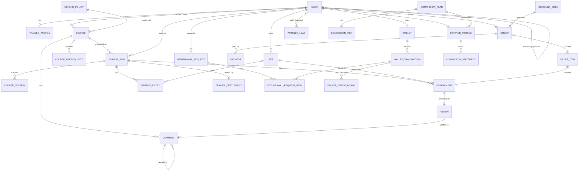

# Website Specification Document — Phase One

### 1. Project Objective

An e-commerce platform for selling training courses tailored to customers' pets. Customers browse courses, reserve a seat for a specific pet in a scheduled run of a course, and pay online or from their in-app wallet. A run only starts once it has enough reservations. Trainers publish their own courses (after admin approval), relaunch them as new runs whenever they like, and earn a share of each run's sales. Partners (pet shops, clinics, groomers) bring in customers through referral links and earn a commission on their purchases.

---

### 2. User Roles & Authentication

- **Roles:** Admin (Owner), Trainer, Partner, Customer.
- **Authentication:** All users register and log in via Phone Number using SMS OTP (One-Time Password).
- Each phone number has **exactly one role** in phase one.

| Role         | Main capabilities                                                                                                                                         |
| ------------ | --------------------------------------------------------------------------------------------------------------------------------------------------------- |
| **Admin**    | Super admin. Manages everything: users, courses, runs, approvals, orders, refunds, discounts, wallets, withdrawals, earnings, commissions, comments, settings. |
| **Trainer**  | Creates own courses and submits them for approval, schedules runs, sees reservations, records each pet's result, replies to comments, sees own earnings.  |
| **Partner**  | Sees own referral link and QR code, adds pre-registration leads, views referred customers, revenue and commission.                                       |
| **Customer** | Manages own pets, reserves and pays for course runs, follows each pet's progress, asks questions, reviews courses and trainers.                          |

**OTP rules:**

- Phone numbers are normalized to one format (e.g. `09xxxxxxxxx`) before storing or matching.
- The code is 5 digits, valid for **2 minutes**, and can be resent after **60 seconds**.
- After **5 wrong attempts** the code is invalidated and the user must request a new one.
- Requests are rate-limited per phone number and per IP to prevent SMS abuse.
- Only customers can self-register. Trainer and Partner accounts are created or promoted by an Admin.
- Blocked users cannot log in.

---

### 3. Core Features & Business Logic

#### 3.1 Courses and Course Runs

The catalogue is split into two levels:

- **Course** is the curriculum: what is taught, to which pets, what they must have passed first, the refund policy, and the trainer's share. It is approved once.
- **Course Run** is one scheduled class of that course: who teaches it, when and where, how many seats, and at what price. A course can have many runs over time, including several at once (e.g. one in Tehran and one online).

Pets enroll in a **run**, but they pass a **course**. Prerequisites always point to a course, so passing any run of "اطاعت‌پذیری مقدماتی" satisfies a prerequisite on that course, no matter which run, trainer or season it was.

#### 3.2 Course Creation & Approval

- Courses can be created by both **Admins** and **Trainers**.
- Courses submitted by Trainers require **Admin approval** before they can have public runs.
- The trainer picks the course's **Refund Policy** from the presets the Admin has defined (see 3.6).
- The course's **Trainer Share** is pre-filled from the platform default (see 3.8). The trainer sees it when submitting; the Admin can change it during review like any other field.
- Courses created by an Admin are approved directly.

**Reviewing a submitted course.** The Admin can:

- **Approve** it as is.
- **Reject** it with a written reason. The trainer sees the reason, edits the course, and resubmits it.
- **Edit** any field (including the refund policy and trainer share) and then either:
  - **Send it back to the trainer for confirmation.** The trainer sees each changed field with its old and new value, plus the Admin's note. Accepting approves the course; editing it again resubmits it for approval.
  - **Force approve** it with the changes. The trainer is notified of what changed.

**After approval:**

- Trainers can still edit text and images.
- Prerequisites, target species, age range, refund policy and trainer share are Admin-only, because they change which pets can enroll, what customers are promised, or what the trainer earns. Admin edits on an approved course apply immediately, and the trainer is notified.
- An Admin can **archive** a course. Archived courses can't get new runs, but existing runs continue and passing them still counts as a prerequisite.

**Course status flow:**

```text
Draft → Pending Approval → Approved → Archived

Pending Approval → Rejected                       → (trainer edits) → Pending Approval
Pending Approval → Awaiting Trainer Confirmation → (trainer accepts) → Approved
                                                 → (trainer edits)   → Pending Approval
Pending Approval → (Admin edits + force approve)  → Approved
```

#### 3.3 Course Runs & Reservations

- A run can be created only for an **Approved** course.
- A trainer can create runs only for courses they own. The Admin can create a run for any course and assign any trainer, and can change a course's owner trainer (e.g. when a trainer leaves).
- Runs **don't need Admin approval**. A trainer can relaunch a course with one click: the new run copies the previous run's price, capacity, location and schedule note, and starts as a Draft with empty dates.
- Each run has:
  - **Capacity:** the maximum number of pets that can reserve it.
  - **Minimum to start:** the number of reservations needed for the run to go ahead.
  - **Enrollment deadline:** the last moment a seat can be reserved (defaults to the start date).
- Once a run has reservations, its price, start date, capacity and location are locked for trainers. Only an Admin can change them, and affected customers are notified by SMS.

The course page shows the course content, its rating, approved reviews and questions, and a list of upcoming runs. For each run, customers see:

- Trainer (with rating), format and location.
- Start date, estimated duration (e.g. "۶ هفته · ۱۲ جلسه") and schedule.
- Price and refund policy summary.
- How many pets have reserved.
- How many more reservations are needed for the run to start (if the minimum isn't reached yet).
- How many seats are left, or "تکمیل ظرفیت" with a "join waitlist" option when full.

**Run status flow:**

```text
Draft → Published → Confirmed → In Progress → Completed
            ↓           ↓
        Cancelled   Cancelled
```

- **Published:** visible to the public and open for reservations until the deadline or until full.
- **Confirmed:** the minimum number of reservations is reached. The run will definitely happen, and customers are notified. It stays open for reservations until full or until the deadline.
- **In Progress / Completed:** set automatically from the start and end dates, or manually by the trainer.
- **Cancelled:** if the minimum isn't reached by the enrollment deadline, the run is cancelled automatically. All paid reservations are refunded in full to the customers' wallets and customers are notified. An Admin can also cancel a run manually with a reason.

**Reservation rules:**

- A seat is held for **15 minutes** while the customer pays. If payment isn't completed, the seat is released.
- **A run must never be overbooked**, even when many customers try to reserve the last seats at the same moment (e.g. right after a popular trainer announces a run). Paid reservations, checkout holds and waitlist offers all take a seat, and taking a seat must be all-or-nothing: if two customers race for the last seat, exactly one gets it and the other is told the run is full.
- Expired checkout holds and waitlist offers free their seat automatically, without anyone having to visit the page.
- A pet can't hold active reservations in two runs of the same course at the same time.
- Cancellations and refunds follow the rules in 3.6.

#### 3.4 Waitlist

- A customer can put an eligible pet on a run's waitlist **only while the run is full and its seats are still held by `Reserved` customers who could cancel**, i.e. the run is `Published` or `Confirmed`, it hasn't started, and the enrollment deadline hasn't passed.
- Joining is free. One entry per pet per run. The customer can leave at any time.
- When a seat frees up, the first pet in line gets an **offer** by SMS. The seat is held for them for **12 hours** (or until the enrollment deadline, if sooner). If they don't pay in time, the offer moves to the next pet in line.
- Accepting an offer goes through the **normal checkout**: an order is created, discount codes and the wallet can be used, the partner is attributed, and the pet's enrollment is reserved once payment succeeds. The only difference is that the seat is already held for them. If a payment attempt fails, they can retry until the offer expires.
- When the run starts, passes its deadline, or is cancelled, all remaining entries are closed and the customers are notified.

#### 3.5 Course Prerequisites & Eligibility

- Customers enroll their specific **Pets** into course runs (not the human customer).
- A course can require passing one or more other courses as prerequisites. A prerequisite is met when the pet has **Passed** any run of the required course.
- A course can also limit eligible pets by **species** and **age range**. Age is checked against the run's start date.
- If a selected pet has not completed the prerequisite(s) or doesn't meet the eligibility rules, enrollment is disabled for that pet, and a custom explanation is displayed (written by the course creator, e.g. "لئو اول باید دوره «اطاعت‌پذیری مقدماتی» را بگذراند").
- **Retakes are allowed.** If the selected pet has already passed this course, the customer sees a notice (e.g. "لئو این دوره را قبلاً با موفقیت گذرانده است") and must confirm before continuing.
- Prerequisites can't form a cycle (course A requires B, B requires A).

#### 3.6 Cancellation & Refunds

The Admin defines a few **Refund Policy** presets, and each course uses one. Example presets:

| Preset              | Full refund until    | Then, until start | After start |
| ------------------- | -------------------- | ----------------- | ----------- |
| منعطف (Flexible)    | 3 days before start  | 50%               | 0%          |
| متوسط (Moderate)    | 7 days before start  | 50%               | 0%          |
| سخت‌گیرانه (Strict) | 14 days before start | 0%                | 0%          |

**Rules:**

- A customer who cancels **before the run is Confirmed** always gets a full refund, whatever the policy.
- After confirmation, the course's refund policy decides the amount, based on how many days are left until the start date.
- If the **platform cancels** a run (minimum not reached, or Admin cancellation), every customer gets a full refund.
- Refund percentages apply to what the customer **actually paid** for that pet's seat, after any discount.
- The policy is **copied onto each order item** at purchase time, so later changes to the course don't affect existing reservations.
- Refunds go to the customer's **wallet** instantly. The customer can then withdraw them to a bank account (see 3.9).
- The Admin can issue a manual refund of any amount, with a reason.

#### 3.7 Discount Codes

The Admin creates discount codes. Each code has:

- **Type and value:** a percentage (with an optional maximum discount amount) or a fixed amount.
- **Validity period:** start and end date.
- **Usage limits:** total number of uses, and uses per customer.
- **Minimum order amount** (optional).
- **Scope:** all courses, or only selected courses.
- **First order only** (optional): only for customers who have never had a paid order.

**Rules:**

- One code per order.
- A fixed-amount discount is split across the order's items in proportion to their price, so each pet's seat has a known paid amount for refunds.
- A use is counted when the order is paid. If the order is fully refunded, the use is given back.
- Discounts are funded by the platform: they don't reduce the trainer's earning (see 3.8). Partner commission is calculated on what the customer actually paid (see 3.11).

#### 3.8 Trainer Earnings

- Each course has a **Trainer Share** percentage. The trainer who teaches a run earns that share of the run's sales.
- The share is calculated on the run's **price**, not the discounted amount, because discounts are the platform's cost.
- If part of a seat's payment is refunded, the trainer's earning for that seat is reduced by the same proportion.
- The share is copied onto each order item at purchase time, so later changes to the course don't affect existing reservations.
- When a run is **Completed**, the system creates a **run settlement** for the trainer: the seats sold, the refund deductions, and the earning. The Admin reviews it, can adjust the amount with a note, and approves it. The approved amount is credited to the trainer's **wallet**.
- The trainer dashboard shows the estimated earning of each upcoming and running run, and the history of settlements.
- Partner commissions are paid from the platform's part, not the trainer's.

#### 3.9 Wallet

Every user (customer, trainer and partner) has an in-app wallet holding real money in **Rial** (not points or app credit).

- **Money in:** top-up through the payment gateway, refunds, trainer earnings, partner commissions, and Admin adjustments.
- **Money out:** paying for orders and withdrawals.
- **History:** every credit and debit is kept as its own entry, and entries are never edited or removed. A mistake is fixed with a new, correcting entry. The user can see their full history.
- **Paying with the wallet:** at checkout, the wallet balance is used first and the rest is paid through the gateway. The wallet part is taken when the order is created and returned if the order fails or expires.
- **Where the balance comes from:** spending always uses the oldest credits first, and each spending records which credits it used and how much of each. That way, the balance can always be explained as a list of credits (e.g. "۲۰۰ هزار تومان از بازگشت وجه دوره X، ۵۹۰ هزار تومان از کمیسیون مهر") without ever editing a past entry.
- **Reversed spending:** when a wallet payment is returned (e.g. the order failed), the money goes back to the credits it came from, so it keeps its original source.
- The balance can never go negative.
- Admin adjustments always require a reason.

**Withdrawal:**

1. The user requests to withdraw their balance to a bank account (Sheba number and account holder name).
2. The request enters the Admin's **withdrawal queue**. While it's waiting, the amount is held and can't be spent.
3. When the Admin opens the request, they see the **itemized list of credits** that make up the balance (type, date, source and remaining amount).
4. The Admin can **deselect** specific items (e.g. a top-up that was never spent). Deselected items stay in the user's wallet and can be spent again.
5. The Admin approves the adjusted payout amount, which is the total of the selected items, and it's taken from the wallet. Then the Admin pays it manually and records the bank tracking code.
6. Or the Admin rejects the whole request with a reason, and the held amount is released.

The user is notified at each step, including which items were left out and why.

#### 3.10 Partner (Affiliate) System

- Partners have a dedicated dashboard with a unique **Referral Link** and **QR Code**.
- **Dashboard Metrics:** Partners can view referred customers and the total revenue generated from their purchases, filterable by date range. Each referred customer shows signup date, number of paid orders, and total spend. The dashboard also shows this month's estimated commission, the current tier, how much more revenue is needed to reach the next tier, and past commission statements.
- **Pre-registration Attribution:** Partners can enter a customer's phone number before the customer signs up. If that customer later registers without a referral link, they are automatically credited to that Partner.

**Attribution rules:**

- A customer is attributed to **one partner, permanently**, at the moment of registration.
- A referral link (or QR code) used at signup takes priority over a pre-registration lead.
- If several partners add the same phone number as a lead, the **earliest** lead wins.
- A lead can't be added for a phone number that is already registered.
- Each order stores the partner it was attributed to at purchase time, so dashboard numbers don't change retroactively.
- Only **paid** orders count toward revenue. Refunded amounts are subtracted.

#### 3.11 Partner Commission

The exact numbers aren't decided yet, so the formula is **configurable by the Admin** through **Commission Plans**. One plan is the global **default**. The Admin can create other plans and assign one to a specific partner, which overrides the default for that partner.

**Inputs** (calculated by the system for each partner and each Jalali month):

- **Net referred revenue:** total of paid orders from the partner's customers in the month (after discounts), minus refunds made in the month. Only orders inside the attribution window count.
- **New customers:** referred customers whose first paid order is in this month.

**Parameters** (set by the Admin on each plan):

- **Rate tiers:** a list of "from this monthly revenue → this percentage". The first tier starts at 0 and is the base rate. The tier reached by the month's net revenue applies to **all** of that month's revenue.
- **First-order bonus:** an optional fixed amount for each new customer.
- **Attribution window:** optional number of months after signup during which a customer's orders earn commission. Empty means forever.

**Formula:**

```text
commission = net referred revenue × rate of the tier reached
           + new customers × first-order bonus
```

Example plan: 0 → 5%, from 500,000,000 Rial → 7%, from 2,000,000,000 Rial → 10%, plus a 1,000,000 Rial first-order bonus. A partner with 800,000,000 Rial net revenue and 3 new customers earns `800,000,000 × 7% + 3 × 1,000,000 = 59,000,000` Rial.

**Settlement:**

- At the start of each Jalali month, the system creates a draft **commission statement** for each partner for the previous month. It copies the plan values it used, so later plan changes don't alter it.
- The Admin reviews it, can adjust the amount with a note, and approves it. The approved amount is credited to the partner's **wallet**, from where they can withdraw it (see 3.9).

#### 3.12 Reviews, Comments & Questions

**Reviews:**

- After a run is **Completed**, the customer can review it once per enrollment.
- A review has a **course rating** (1–5), a **trainer rating** (1–5), and an optional **comment**.
- Ratings count toward the averages immediately. The comment follows the comment rules below.
- Course and trainer averages and counts are shown on the course page and the trainer's profile.

**Comments and questions:**

- Any logged-in customer can post a comment or question on a course page, even before enrolling. A review's comment appears in the same list, with its ratings.
- Customer comments are shown **only after Admin approval**. The Admin can approve or reject a comment with a reason.
- The course's owner trainer, any trainer who has taught a run of it, and the Admin can **reply**. Replies are shown immediately. Replies are one level deep.
- The customer is notified when their comment gets a reply.
- The Admin can **hide** any comment or reply at any time, with a reason. Hiding a comment also hides all its replies. A hidden comment can be restored.
- Comments show the customer's first name, and the pet's name when there is one (e.g. "سارا، همراه لئو").

---

### 4. Database Entities & Relationships

#### Shared conventions

These apply to every entity and are not repeated in each table:

- **ID:** UUID primary key.
- **Timestamps:** `Created At` and `Updated At` on every table, stored in UTC and shown in the Jalali calendar.
- **Soft delete:** entities with history (User, Pet, Course, Course Run) use `Deleted At` instead of being removed.
- **Money:** stored as integers in **Rial**. No floating-point amounts. The UI shows toman (Rial ÷ 10), shortened as "هزار" or "میلیون".
- **Snapshots:** values that can change later (price, partner, refund policy, trainer share, commission plan) are copied at the moment they're used.

#### Relationship overview



#### **1. User**

| Field                    | Notes                                          |
| ------------------------ | ---------------------------------------------- |
| Phone Number             | Unique, normalized.                            |
| Phone Verified At        | Set on first successful OTP.                   |
| First Name, Last Name    | Used in personal greetings.                    |
| Avatar                   | Optional image.                                |
| Role                     | `Admin`, `Trainer`, `Partner`, `Customer`.     |
| Status                   | `Active`, `Blocked`.                           |
| Referred By (Partner ID) | Customers only. Optional.                      |
| Referral Source          | `Link`, `QR Code`, `Pre-registration`, `None`. |
| Referred At              | When attribution happened.                     |
| Last Login At            |                                                |

- **Relations:** Has one **Wallet**. Has one **Trainer Profile** or **Partner Profile** depending on role. A Customer has many **Pets** and **Orders**.

#### **2. Trainer Profile**

| Field                        | Notes                                        |
| ---------------------------- | -------------------------------------------- |
| User ID                      | One-to-one with a `Trainer` user.            |
| Bio                          | Shown on course and run pages.               |
| Specialties                  | e.g. obedience, behaviour, agility.          |
| Years of Experience          |                                              |
| Certificates                 | Uploaded files or titles.                    |
| City                         |                                              |
| Verified At                  | Set by an Admin. Shows the "تأییدشده" badge. |
| Rating Average, Rating Count | From reviews.                                |

#### **3. Partner Profile**

| Field              | Notes                                                    |
| ------------------ | -------------------------------------------------------- |
| User ID            | One-to-one with a `Partner` user.                        |
| Business Name      | e.g. the pet shop's name.                                |
| Business Type      | `Pet Shop`, `Veterinary Clinic`, `Groomer`, `Other`.     |
| Referral Code      | Unique, short, used in the referral link and QR code.    |
| Commission Plan ID | Optional. Empty means the default plan.                  |
| City, Address      |                                                          |
| Is Active          | Inactive partners' links stop attributing new customers. |

#### **4. Pet**

| Field               | Notes                                                       |
| ------------------- | ----------------------------------------------------------- |
| Owner (Customer ID) |                                                             |
| Name                |                                                             |
| Species             | `Dog`, `Cat`, `Bird`, `Other`.                              |
| Breed               | Free text or from a list.                                   |
| Sex                 | `Male`, `Female`.                                           |
| Birth Date          | Approximate is fine. Age is calculated from it, not stored. |
| Weight (kg)         |                                                             |
| Is Neutered         |                                                             |
| Photo               |                                                             |
| Microchip Number    | Optional.                                                   |
| Vaccination Status  | `Up to date`, `Partial`, `Unknown`.                         |
| Behaviour Notes     | Shown to the trainer (e.g. fear of other dogs).             |
| Medical Notes       | Shown to the trainer.                                       |

- **Relations:** Belongs to a **Customer**; Has many **Enrollments** and **Waitlist Entries**.

#### **5. Course (Curriculum)**

| Field                        | Notes                                                                                             |
| ---------------------------- | ------------------------------------------------------------------------------------------------- |
| Title, Slug                  | Slug is unique and used in the URL.                                                               |
| Short Description            | Shown on course cards.                                                                            |
| Description                  | Full rich-text content.                                                                           |
| Cover Image                  |                                                                                                   |
| Category                     | e.g. `Obedience`, `Behaviour`, `Agility`, `Puppy`.                                                |
| Level                        | `Beginner`, `Intermediate`, `Advanced`.                                                           |
| Created By (User ID)         | Admin or Trainer.                                                                                 |
| Owner Trainer ID             | The trainer allowed to schedule runs. Empty for Admin-created courses. Changeable by Admin only.  |
| Target Species               | One or more species.                                                                              |
| Min / Max Pet Age (months)   | Optional eligibility range.                                                                       |
| Session Count                | e.g. 12. Part of the curriculum, the same for every run.                                          |
| Session Duration (minutes)   | e.g. 60.                                                                                          |
| Estimated Duration (weeks)   | Shown as "۶ هفته".                                                                                |
| Default Price                | Pre-filled into new runs. Each run sets its own price.                                            |
| Refund Policy ID             | Picked by the trainer, changeable by the Admin.                                                   |
| Trainer Share (%)            | Pre-filled from the platform default, changeable by the Admin.                                    |
| Ineligibility Message        | Custom text shown when a pet fails prerequisites or eligibility.                                  |
| Status                       | `Draft`, `Pending Approval`, `Awaiting Trainer Confirmation`, `Rejected`, `Approved`, `Archived`. |
| Rejection Reason             | Set when an Admin rejects it.                                                                     |
| Admin Changes                | List of fields the Admin changed during review, each with old and new value.                      |
| Admin Note                   | Shown to the trainer with the changes.                                                            |
| Approved By, Approved At     |                                                                                                   |
| Archived At                  |                                                                                                   |
| Rating Average, Rating Count | From reviews.                                                                                     |

- **Relations:** Has many **Prerequisites**, **Course Runs** and **Comments**; uses one **Refund Policy**.

#### **6. Course Prerequisite**

| Field              | Notes                                                         |
| ------------------ | ------------------------------------------------------------- |
| Course ID          | The course that has the requirement.                          |
| Required Course ID | The course the pet must have **Passed** (in any of its runs). |

- Unique on (Course ID, Required Course ID). A course can't require itself.

#### **7. Course Run (Cohort)**

| Field                             | Notes                                                                       |
| --------------------------------- | --------------------------------------------------------------------------- |
| Course ID                         | Must be an `Approved` course.                                               |
| Trainer ID                        | The trainer who teaches this run.                                           |
| Label                             | Optional, shown next to the course title (e.g. "پاییز ۱۴۰۵ · تهران").       |
| Format                            | `In Person`, `Online`, `Hybrid`.                                            |
| City, Location / Address          | For in-person runs.                                                         |
| Start Date                        |                                                                             |
| Estimated End Date                |                                                                             |
| Schedule Note                     | e.g. "شنبه و چهارشنبه، ساعت ۱۷".                                            |
| Enrollment Deadline               | Defaults to the start date.                                                 |
| Capacity                          | Max reservations.                                                           |
| Min Reservations to Start         | Must be ≤ Capacity.                                                         |
| Price                             | Rial.                                                                       |
| Status                            | `Draft`, `Published`, `Confirmed`, `In Progress`, `Completed`, `Cancelled`. |
| Published At                      |                                                                             |
| Confirmed At                      | When the minimum was reached.                                               |
| Cancelled At, Cancellation Reason |                                                                             |

**Calculated values** (from active enrollments, not entered by hand):

- **Reserved Count:** enrollments with status `Reserved`, `In Progress`, `Passed` or `Failed`, plus unexpired `Pending Payment` holds and unexpired waitlist offers.
- **Remaining to Start:** `max(0, Min Reservations to Start − Reserved Count)`.
- **Remaining Seats:** `Capacity − Reserved Count`.
- **Is Enrollment Open:** status is `Published` or `Confirmed`, the deadline hasn't passed, and seats remain.
- **Is Waitlist Open:** status is `Published` or `Confirmed`, the deadline hasn't passed, and no seats remain.

Reserved Count can be cached on the run row for fast listing, but it must be updated in the same transaction as the enrollment.

- **Relations:** Belongs to a **Course** and a **Trainer**; Has many **Course Sessions**, **Enrollments** and **Waitlist Entries**; has one **Trainer Settlement** once completed.

#### **8. Course Session**

| Field              | Notes                            |
| ------------------ | -------------------------------- |
| Course Run ID      |                                  |
| Order              | 1, 2, 3…                         |
| Title              | e.g. "آشنایی با فرمان‌های پایه". |
| Starts At          |                                  |
| Duration (minutes) | Defaults to the course's value.  |
| Location / Link    | Overrides the run's location.    |

- Optional in phase one. Without it, the run's Schedule Note is enough.

#### **9. Course Enrollment / Progress**

| Field                             | Notes                                                                                      |
| --------------------------------- | ------------------------------------------------------------------------------------------ |
| Course Run ID, Pet ID             |                                                                                            |
| Course ID                         | Copied from the run, so prerequisite checks don't need to go through runs.                 |
| Customer ID                       | Copied from the pet's owner for easier queries.                                            |
| Order Item ID                     |                                                                                            |
| Is Retake                         | The pet had already passed this course when it enrolled.                                   |
| Status                            | `Pending Payment`, `Reserved`, `Cancelled`, `Refunded`, `In Progress`, `Passed`, `Failed`. |
| Hold Expires At                   | For `Pending Payment`. The seat is released after this.                                    |
| Reserved At                       | When payment succeeded.                                                                    |
| Cancelled At, Cancellation Reason |                                                                                            |
| Attended Sessions                 | Count, updated by the trainer.                                                             |
| Completed Date                    | Set when the result is recorded.                                                           |
| Trainer Note                      | Feedback for the customer.                                                                 |

- Only one active (not `Cancelled`/`Refunded`) enrollment per (Course ID, Pet ID) among runs that haven't finished.
- _(Note: This tracks whether a specific pet meets the prerequisites for future courses. A prerequisite is met by any `Passed` enrollment with the required Course ID.)_

#### **10. Waitlist Entry**

| Field                 | Notes                                                              |
| --------------------- | ------------------------------------------------------------------ |
| Course Run ID, Pet ID | Unique together.                                                   |
| Customer ID           |                                                                    |
| Status                | `Waiting`, `Offered`, `Enrolled`, `Expired`, `Left`, `Closed`.     |
| Offered At            |                                                                    |
| Offer Expires At      | The held seat is released and offered to the next pet after this. |
| Enrollment ID         | Set when the customer pays for the offered seat.                   |

- Order in line is by `Created At`.

#### **11. Refund Policy**

| Field                    | Notes                                                    |
| ------------------------ | -------------------------------------------------------- |
| Name                     | e.g. "منعطف".                                            |
| Customer Description     | Plain explanation shown on the run page and at checkout. |
| Full Refund Until (days) | Days before start until which the refund is 100%.        |
| Partial Refund (%)       | From then until the start date.                          |
| After Start Refund (%)   | Usually 0.                                               |
| Is Active                | Inactive presets can't be picked for new courses.        |

- Managed by the Admin only.

#### **12. Discount Code**

| Field                       | Notes                                                 |
| --------------------------- | ----------------------------------------------------- |
| Code                        | Unique, case-insensitive (e.g. `NOROOZ1405`).         |
| Description                 | Internal note for the Admin.                          |
| Type                        | `Percentage`, `Fixed Amount`.                         |
| Value                       | Percentage, or amount in Rial.                        |
| Max Discount Amount         | Optional cap for percentage codes.                    |
| Min Order Amount            | Optional.                                             |
| Starts At, Ends At          |                                                       |
| Total Usage Limit           | Optional.                                             |
| Per Customer Limit          | Optional.                                             |
| First Order Only            |                                                       |
| Scope                       | `All Courses`, `Selected Courses`.                    |
| Course IDs                  | When the scope is `Selected Courses`.                 |
| Used Count                  | Paid orders that used it, minus fully refunded ones.  |
| Is Active                   | The Admin can turn a code off at any time.            |

#### **13. Order**

| Field               | Notes                                                                       |
| ------------------- | --------------------------------------------------------------------------- |
| Order Number        | Human-readable, unique (e.g. `ZR-140507-0042`).                             |
| Customer ID         |                                                                             |
| Partner ID          | Snapshot of the customer's partner at purchase time. Optional.              |
| Discount Code ID    | Optional.                                                                   |
| Subtotal            |                                                                             |
| Discount Amount     |                                                                             |
| Total Amount        |                                                                             |
| Paid From Wallet    | Part of the total paid from the wallet.                                     |
| Paid via Gateway    | Part of the total paid online.                                              |
| Refunded Amount     |                                                                             |
| Payment Status      | `Pending`, `Paid`, `Failed`, `Cancelled`, `Refunded`, `Partially Refunded`. |
| Order Date, Paid At |                                                                             |

- _(Note: Used to calculate partner revenue and commission: `Total Amount − Refunded Amount` of paid orders.)_

#### **14. Order Item**

| Field                  | Notes                                                    |
| ---------------------- | -------------------------------------------------------- |
| Order ID               |                                                          |
| Course Run ID          |                                                          |
| Pet ID                 |                                                          |
| Unit Price             | Snapshot of the run's price.                             |
| Discount Amount        | This item's part of the order discount.                  |
| Paid Amount            | Unit Price − Discount Amount. Refunds are based on this. |
| Refund Policy Snapshot | The policy's day and percentage values at purchase time. |
| Trainer Share Snapshot | The course's Trainer Share (%) at purchase time.         |
| Refunded Amount        |                                                          |

- One item per pet per run. An order can reserve several pets or several runs at once.

#### **15. Payment (Gateway)**

| Field                | Notes                                      |
| -------------------- | ------------------------------------------ |
| User ID              |                                            |
| Purpose              | `Order`, `Wallet Top-up`.                  |
| Order ID             | When the purpose is `Order`.               |
| Amount               |                                            |
| Gateway              | Name of the payment gateway.               |
| Gateway Authority    | The token used to start the payment.       |
| Reference ID         | The gateway's tracking code after success. |
| Card Number (masked) | e.g. `6037-99**-****-1234`.                |
| Status               | `Pending`, `Succeeded`, `Failed`.          |
| Failure Reason       |                                            |
| Paid At              |                                            |

- Records only gateway payments. Wallet movements live in Wallet Transaction.
- An order can have several payment attempts. Only one can succeed.
- Gateway callbacks must be verified server-side and handled idempotently (a repeated callback must not reserve or top up twice).

#### **16. Wallet**

| Field          | Notes                                                                           |
| -------------- | ------------------------------------------------------------------------------- |
| User ID        | One-to-one. Created at signup.                                                  |
| Balance        | Rial. Always equals the total of the wallet's transactions. Never negative.     |
| Held Amount    | Part of the balance held by a pending withdrawal request. Can't be spent.       |

#### **17. Wallet Transaction**

| Field            | Notes                                                                                                                       |
| ---------------- | --------------------------------------------------------------------------------------------------------------------------- |
| Wallet ID        |                                                                                                                             |
| Type             | `Top-up`, `Order Payment`, `Order Payment Reversal`, `Refund`, `Trainer Earning`, `Commission`, `Withdrawal`, `Admin Adjustment`. |
| Amount           | Positive for credits, negative for debits.                                                                                  |
| Balance After    |                                                                                                                             |
| Reference        | The related Order, Payment, Withdrawal Request, Trainer Settlement or Commission Statement.                                  |
| Description      | Shown to the user (e.g. "بازگشت وجه دوره اطاعت‌پذیری مقدماتی").                                                             |
| Created By       | The Admin, for adjustments.                                                                                                 |
| Reason           | Required for Admin adjustments.                                                                                             |

- Entries are never edited or deleted. Mistakes are fixed with a new entry.
- How much of a credit is still in the balance isn't stored on the entry. It's the credit's amount minus what its Credit Usages have taken from it.

#### **18. Wallet Credit Usage**

Records which credits each debit used, so the balance can be explained as a list of credits without ever editing an entry.

| Field          | Notes                                                                 |
| -------------- | --------------------------------------------------------------------- |
| Debit ID       | The spending entry (order payment, withdrawal, negative adjustment).  |
| Credit ID      | The credit it used.                                                   |
| Amount         | How much of that credit this debit used.                              |

- One debit can use several credits (oldest first).
- When a debit is reversed (e.g. a failed order returns its wallet part), the reversal is linked to the same credits, so the returned money keeps its original source.
- Like Wallet Transactions, these rows are never edited or deleted.

#### **19. Withdrawal Request**

| Field                      | Notes                                                   |
| -------------------------- | ------------------------------------------------------- |
| User ID                    |                                                         |
| Requested Amount           | The balance at the time of the request.                 |
| Approved Amount            | Total of the items the Admin kept selected.             |
| Sheba Number               | `IR` + 24 digits.                                       |
| Account Holder Name        |                                                         |
| Status                     | `Pending`, `Approved`, `Paid`, `Rejected`.              |
| Admin Note                 | Shown to the user (e.g. why some items were left out).  |
| Rejection Reason           |                                                         |
| Reviewed By, Reviewed At   |                                                         |
| Paid At                    |                                                         |
| Bank Tracking Code         | Entered by the Admin after paying.                      |

#### **20. Withdrawal Request Item**

| Field                  | Notes                                                    |
| ---------------------- | -------------------------------------------------------- |
| Withdrawal Request ID  |                                                          |
| Wallet Transaction ID  | A credit that makes up part of the balance.              |
| Amount                 | How much of the credit was still in the balance at the time of the request. |
| Is Selected            | Deselected items stay in the user's wallet.              |

#### **21. Trainer Settlement**

| Field                    | Notes                                                    |
| ------------------------ | -------------------------------------------------------- |
| Course Run ID            | Unique. One settlement per run.                          |
| Trainer ID               |                                                          |
| Seats Sold               |                                                          |
| Gross Sales              | Total of the seats' run prices.                          |
| Refund Deduction         | Trainer's share of the refunded proportions.             |
| Trainer Earning          | Calculated from each item's Trainer Share Snapshot.      |
| Admin Adjustment, Note   | Optional.                                                |
| Total Amount             |                                                          |
| Status                   | `Draft`, `Approved`, `Credited`.                         |
| Approved By, Approved At |                                                          |
| Wallet Transaction ID    | Set when credited.                                       |

#### **22. Partner Lead (Pre-registration)**

| Field                 | Notes                                                                 |
| --------------------- | --------------------------------------------------------------------- |
| Partner ID            |                                                                       |
| Customer Phone Number | Normalized.                                                           |
| Customer Name         | Optional, to help the partner recognize the lead.                     |
| Note                  | Optional.                                                             |
| Status                | `Pending`, `Claimed`, `Lost` (registered via another partner's link). |
| Claimed By (User ID)  | The customer who registered.                                          |
| Claimed Date          |                                                                       |

- _(Note: Used to match a new customer's phone number upon registration if they didn't use a referral link.)_

#### **23. Commission Plan**

| Field                       | Notes                                         |
| --------------------------- | --------------------------------------------- |
| Name                        | e.g. "پیش‌فرض", "همکاران ویژه".               |
| Is Default                  | Exactly one plan is the default.              |
| First-order Bonus           | Fixed Rial amount per new customer. Optional. |
| Attribution Window (months) | Optional. Empty means forever.                |
| Is Active                   |                                               |

#### **24. Commission Tier**

| Field              | Notes                                                         |
| ------------------ | ------------------------------------------------------------- |
| Commission Plan ID |                                                               |
| From Revenue       | Monthly net referred revenue, in Rial. The first tier is `0`. |
| Rate (%)           |                                                               |

- Unique on (Commission Plan ID, From Revenue).

#### **25. Commission Statement**

| Field                    | Notes                                                       |
| ------------------------ | ----------------------------------------------------------- |
| Partner ID               |                                                             |
| Period                   | Jalali year and month (e.g. `1405-07`).                     |
| Commission Plan Snapshot | The plan's tiers, bonus and window used for this statement. |
| Net Referred Revenue     |                                                             |
| Paid Orders Count        |                                                             |
| New Customers Count      |                                                             |
| Applied Rate (%)         |                                                             |
| Revenue Commission       | Net revenue × applied rate.                                 |
| Bonus Amount             | New customers × first-order bonus.                          |
| Admin Adjustment, Note   | Optional.                                                   |
| Total Amount             |                                                             |
| Status                   | `Draft`, `Approved`, `Credited`.                            |
| Approved By, Approved At |                                                             |
| Wallet Transaction ID    | Set when credited.                                          |

- Unique on (Partner ID, Period).

#### **26. Review**

| Field                    | Notes                              |
| ------------------------ | ---------------------------------- |
| Enrollment ID            | Unique. One review per enrollment. |
| Customer ID, Pet ID      |                                    |
| Course ID, Course Run ID |                                    |
| Trainer ID               |                                    |
| Course Rating            | 1–5.                               |
| Trainer Rating           | 1–5.                               |
| Comment ID               | Optional. The review's comment.    |

#### **27. Comment**

| Field                    | Notes                                                                    |
| ------------------------ | ------------------------------------------------------------------------ |
| Course ID                |                                                                          |
| Author (User ID)         | Customer, Trainer or Admin.                                              |
| Pet ID                   | Optional, shown next to the customer's name.                             |
| Parent Comment ID        | Set for replies. Replies can't have replies.                             |
| Body                     |                                                                          |
| Status                   | `Pending`, `Approved`, `Rejected`, `Hidden`. Replies start as `Approved`. |
| Rejection / Hide Reason  |                                                                          |
| Moderated By, Moderated At |                                                                        |

- A hidden comment hides all its replies, without changing the replies' own status, so restoring the comment brings them back.

#### **28. OTP Code**

| Field        | Notes                                   |
| ------------ | --------------------------------------- |
| Phone Number |                                         |
| Code Hash    | The code is never stored in plain text. |
| Expires At   |                                         |
| Attempts     |                                         |
| Consumed At  | A code can be used only once.           |
| IP Address   | For rate limiting.                      |

#### **29. Platform Setting**

Global values the Admin can change without a code release. Defaults:

| Setting                    | Default        |
| -------------------------- | -------------- |
| Default trainer share      | To be decided  |
| Seat hold during payment   | 15 minutes     |
| Waitlist offer duration    | 12 hours       |
| OTP validity / resend wait | 2 min / 60 sec |
| OTP max attempts           | 5              |
| Minimum withdrawal amount  | To be decided  |
